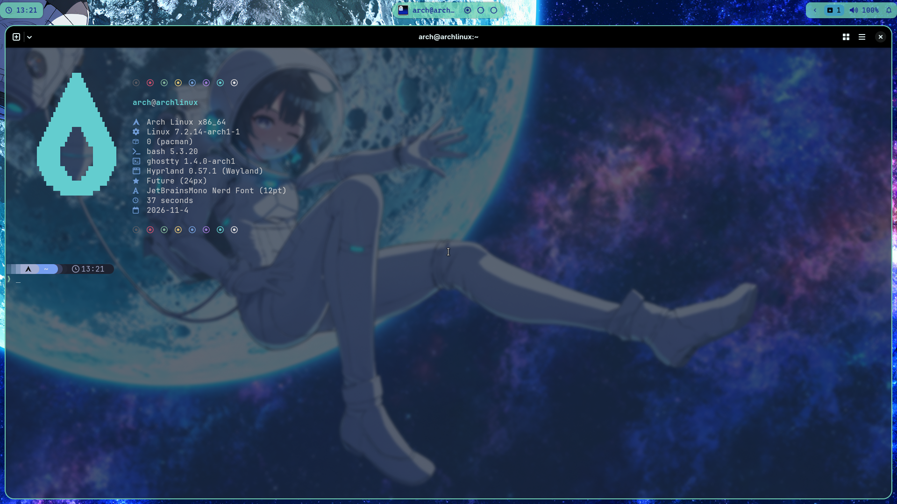
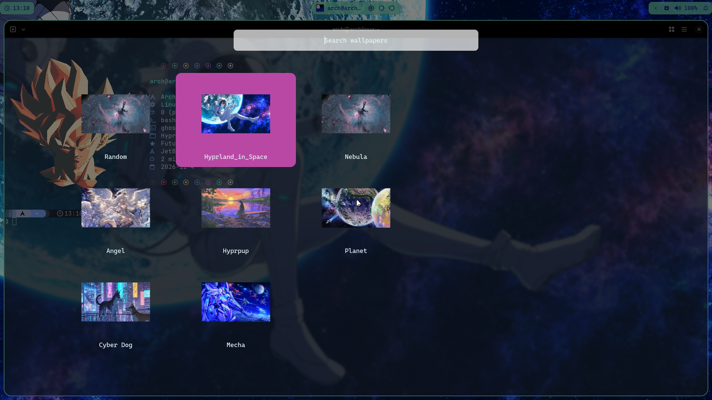
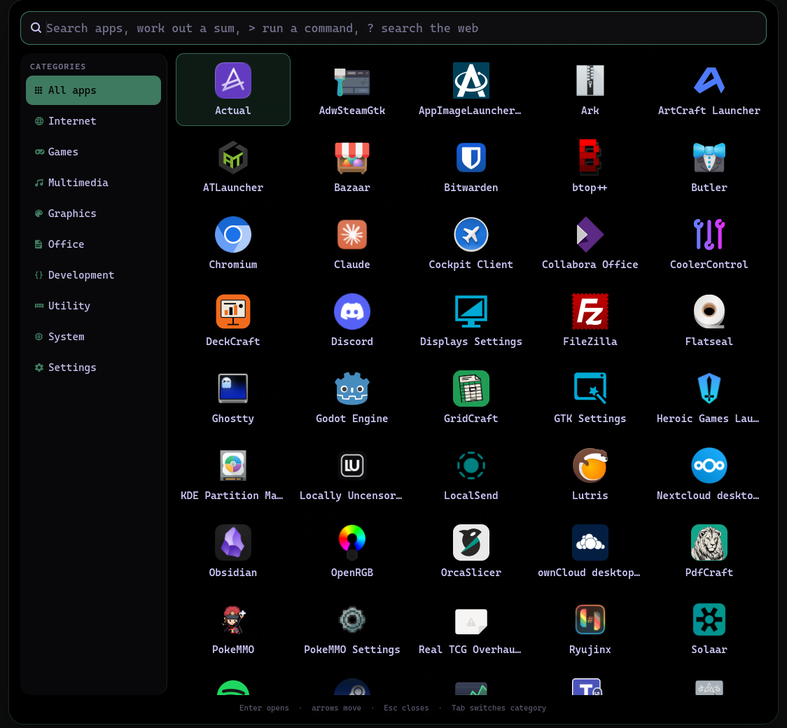
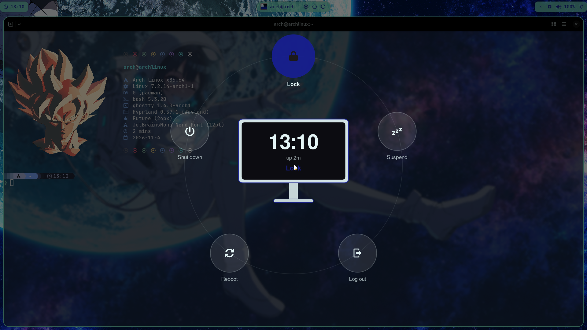

#  Hyprland Dotfiles 

This is the configuration I am currently using for Hyprland
I have tried many dots in the past and I liked them but not ALL of what each one offered so I decided to make my own config
I have borrowed some code from the dots I like (especially JaKoolIt) but have also added my own spin on some things

I have also made an install script that should install everything nicely (I even left in the dry-run command just so you can see exactly what it is doing)

I have added some wallpapers I've collected (will probably add more as I go)

### **Keybinds**

 + Space = Launcher  
 + Q = Quit app  
 + T = Terminal (Ghostty as default)  
 + C = PC assistant (optional, see below)  
 + CTRL + C = Clipboard history  
 + E = File Manager (Thunar is default)  
 + B = Browser (Zen is default)  
 + A = App Store (Bazaar is default)  
 + N = Refresh waybar  
 SHIFT + N = Launch waybar (used if waybar crashes)  
 + W = Launch wallpaper selecter  
 + TAB = See all workspaces, with live window pictures  
ALT + TAB = Switch windows  
 + . = Emoji picker  
 SHIFT + C = Pick a colour on screen  
 ALT + R = Record this screen (again to stop).  ALT + SHIFT + R records an area  
PRINT = Screenshot this screen. CTRL + SHIFT + S a region, CTRL + ALT + S a window  

### Default Desktop


### Terminal


### **JaKoolIt** Wallpaper selector


### App launcher
Super+Space. Type to find an app; it also works out sums (`12*7`, Enter copies the answer), runs commands in your terminal (`> htop`), searches the web (`? arch wiki bluetooth`) and offers lock, sleep, log out, reboot and shut down (the last four ask for a second Enter). Apps you open often come first. Five styles, picked on the settings Launcher page: Categories, Spotlight, Grid, Compact and Dock. Colours and font follow the Theme page.


### Quick tray
The bar's bell opens one panel, like a phone's: quick settings (Wi-Fi, Bluetooth, do not disturb, stay awake, game mode, recording, night light, system sounds), volume and microphone with a device picker, what is playing, shortcuts, a system monitor with two-minute graphs, drive space with a button to eject USB drives, the batteries of wireless mice and keyboards, and your notifications at the bottom, one line until you click them.

Anything your PC lacks is left out, so battery, brightness, touchpad and airplane mode only show on a laptop. The same background process (`.config/hypr/tray/`) draws the volume popup, Alt+Tab and the overview, warns when a battery runs low, and puts the PC to sleep at 3%. swaync is still the notification daemon behind it. Notification buttons such as Reply work on the popups, not in the tray.

USB drives mount when you plug them in, with a notification to open them, and drives inside the PC are left alone (`.config/hypr/udiskie.yml`). When a screen comes back, its workspaces return to it.

### Powermenu
Full screen, with a PC (a laptop when a battery is found) in the middle and the options in a ring around it. Arrow keys, the first letter of an option, or the mouse.


### Install:

The installer is for **Arch Linux** (it uses `pacman` and `paru`) and expects a Hyprland 0.55+ session with the Lua config. Run it as your normal user; it asks for `sudo` when needed. It opens a full-screen installer: answer a few questions (keyboard, graphics drivers, browser, extra apps, Hearthling), check the summary, and it does the rest while showing its progress. Try `./hyprinstall.sh --dry-run` first: you get the same screens, and nothing is installed or changed. `--plain` asks in plain text instead.

```bash
git clone https://github.com/daigonstar/hyprdots.git
cd hyprdots
chmod +x hyprinstall.sh
./hyprinstall.sh
```
The installer enables multilib (needed for Steam), auto-detects your GPU (AMD, NVIDIA or Intel) and installs the matching drivers from `install/gpu-<vendor>.txt`. Force the choice with `HYPR_GPU="amd nvidia" ./hyprinstall.sh`. `install/hide.sh` hides unwanted app launcher entries listed in `install/hide.txt`. It also enables the needed services. The PC assistant is optional (see below).
#### What gets installed

`install/required.txt` is the desktop itself. Everything else is your choice: the installer asks which web browser you want and offers these groups, none of them needed (`install/apps/`):

| Group | Apps |
|---|---|
| `store` (on by default) | Bazaar, Flatseal |
| `media` | VLC, Spotify, cava |
| `office` | Collabora Office, Obsidian |
| `sharing` | Nextcloud, LocalSend, FileZilla, Bitwarden |
| `chat` | Discord, Vesktop, Teams |
| `gaming` | Steam, Lutris, Heroic, Ryujinx, PokeMMO |
| `dev` | Zed, GitHub command line, sif |
| `hardware` | OpenRGB, CoolerControl, Solaar |
| `windows` | WinBoat, Docker, FreeRDP |

Add more any time with `install/apps.sh`. To answer ahead of time, use `HYPR_APPS="gaming chat" HYPR_BROWSER=zen ./hyprinstall.sh --plain` (or `all`, or `none`).

#### Updating

New installs follow the `stable` branch, which only moves once a version has passed its tests; `main` is the newest and may break. The branch you follow is kept in `.update-branch`, so change or delete that file to switch. Each update lists what changed, and keeps the list in `~/.local/state/hyprdots/last-update.txt`.

`update.sh` (or `hyprupdate`) leaves your settings alone. Everything the settings app saves is in local files git ignores, and those are never touched, along with any files you added yourself. If you edited a shipped file by hand, your edit is put back on top of the update. If it clashes with the update, the new version goes in and yours is saved in `~/.local/state/hyprdots/update-backups/`, with a notification. If you have commits that are not pushed, the update stops and changes nothing. Updates only add packages the desktop itself needs, never the optional apps.

### PC assistant (optional)

A local AI helper (Super+C or the bar button) that answers questions about your PC, calendar and the web. It runs through Ollama, so nothing leaves your machine, but it needs a reasonably strong GPU. The installer asks, shows what it detected and recommends a size:

| Tier | Chat model | Vision model | Download | Needs |
| --- | --- | --- | --- | --- |
| `full` | gpt-oss:20b | qwen2.5vl:7b | ~19 GB | 16 GB GPU memory |
| `balanced` | qwen3:8b | qwen2.5vl:3b | ~8 GB | 8 GB GPU memory |
| `light` | qwen3:4b | none | ~3 GB | 4 GB GPU memory, or CPU only (slow) |
| `custom` | any Ollama model | optional | - | - |
| `none` | no assistant | | 0 | |

The assistant is tuned for gpt-oss; smaller models are less reliable with tools. Choosing `none` installs no Ollama and hides the bar button; Super+C shows a hint instead. Change your mind any time:

    ~/.config/hypr/assistant/setup.sh                 # menu
    ~/.config/hypr/assistant/setup.sh --none          # turn it off
    ~/.config/hypr/assistant/setup.sh --tier balanced
    ~/.config/hypr/assistant/setup.sh --model qwen3:14b --vision-model none
    HYPR_ASSISTANT=none ./hyprinstall.sh              # unattended install choice

For web research, `setup.sh` also starts a private [SearXNG](https://docs.searxng.org/) search service in Docker or Podman when either is available (about 150 MB of RAM, idle CPU, 400 MB of disk). It listens on `127.0.0.1:8888`, so only this PC can reach it, and restarts on boot. Public search engines block or throttle scripts, so without it the assistant's searches are much narrower. Skip it with `--no-search`, or remove it later with `docker rm -f searxng`; its config lives in `~/.config/searxng/settings.yml` and is never overwritten.

Your choice is stored in `~/.config/hypr/user_settings.local.toml` (git-ignored). Without a vision model the screenshot and `/paste` features switch themselves off. If your chat model can see images (qwen3.5 can), set the vision model to **Same as chat model** in the settings app (or `vision_model = "same"`): one model does both, so there is no second download and nothing extra to load. The background health monitor is separate and needs no model.

Describe your own machine to the assistant in `~/.config/hypr/assistant/agent_context.md` (hardware, distribution, package manager, things that are deliberately odd). `setup.sh` creates it from the tracked template `agent_context.example.md` the first time and never overwrites it; it is git-ignored, and `update.sh` preserves it.

### Settings app

Click the cog in the quick tray (or run `~/.config/hypr/scripts/settings.sh`) for a settings window where you can change things without editing files. It uses your wallpaper's colours, and on a narrow or rotated screen it shows the page list and the page one at a time. Over SSH, or with `settings.sh --tui`, the same settings open as a terminal app instead.

| Page | What you can change |
| --- | --- |
| Assistant | Pick the chat and vision model from the ones you have installed (or download one), thinking effort, memory use, colours, and switch the assistant on or off |
| Assistant Monitor | The assistant's background health checks (not your screens): when to warn about full disks, heat and failed services, and what to ignore |
| Calendar | Add, rename or remove calendars (links stay private) |
| Cloud drives | Google Drive, OneDrive, Dropbox, Nextcloud and other WebDAV accounts shown as folders in Thunar, and whether opened files are kept on this PC (faster) or streamed from the server (nothing stored) |
| Displays | Resolution, refresh rate, scale, rotation and position of each screen (replaces nwg-displays): drag screens on the map and they snap into place; changes apply at once and undo themselves if you do not confirm |
| Workspaces | Which screen each of the ten workspaces opens on, which one each screen starts on, names, always-shown workspaces and an app to open in an empty one, with quick layouts (alternate, split, all on one screen) |
| Window rules | What happens when a window opens: which workspace or screen it goes to, whether it floats or opens fullscreen, and more. Switch off or change the built-in rules, and add your own with a step-by-step wizard. Yours are kept in `window_rules_local.lua` (git-ignored), so updates leave them alone |
| Theme | One look for the desktop, built from your wallpaper: which wallust colour each part of the bar uses (panels, text, accent, workspaces, icons, notifications), panel opacity, the bar's style (islands, solid strip, floating bar, bubbles or minimal), and its font and size. Apps follow too: GTK apps such as Thunar and the settings window take the same colours (dark or light to match), with their icons, mouse cursor and font (this replaces nwg-look) |
| Bar layout | Start from one of five ready-made layouts (Classic, Two sides, Centre pill, Full strip, Bottom dock), put the bar at the top or bottom, drag its modules between left, centre and right, reorder them, or take them off and put them back. Extra modules to add: now playing, keep awake, keyboard layout, disk space, screen brightness and a privacy indicator |
| Power & lock | When the screen locks, when the screens switch off and when the PC goes to sleep, which screens stay on while locked, and the lock screen's look: wallpaper or blurred background, darkening, clock style, size and position, date, username, password line or box, a grace period, with a Preview button |
| Hyprland | Gaps, borders, rounding, blur, dimming and animations; keyboard layout, key repeat and Caps Lock options; mouse acceleration, left-handed buttons and scroll speed; touchpad tapping and clicking; hiding the pointer; and how focus, workspaces and waking the screens behave |
| Keybinds | Change the key combo for any action: click it and press the new combo |
| File types | Which app opens links, pictures, video, PDFs, archives and other kinds of file |
| Hyprdots | Default terminal, file manager, browser and store, which apps start with the desktop, and whether the Super key is drawn as the Arch logo, Tux or the word SUPER |

Every option has a short explanation and says when it takes effect. The Displays, File types and Cloud drives pages apply straight away. On the other pages changes are held until you save: a bar at the bottom says how many are pending, with **Save** (Ctrl+S) and **Discard**, and changed options are marked *unsaved*. Your choices are saved to `~/.config/hypr/user_settings.local.toml` (and `user_overrides.lua` for the Hyprland look and apps); both are git-ignored, so updating the dotfiles never undoes them. The shared `user_settings.toml` only holds the defaults. Options you have changed are marked *custom*, with an undo button to go back to the default.

### User settings

The settings app edits these files for you; you can also edit `~/.config/hypr/user_settings.toml` (shared defaults) and `~/.config/hypr/user_settings.local.toml` (yours, and it wins) by hand.

Private values go in `~/.config/hypr/user_settings.local.toml` (git-ignored, created by the installer from `user_settings.local.toml.example`). To show Google Calendar events in the clock popup, copy your calendar's *Secret address in iCal format* (Google Calendar → Settings → your calendar → Integrate calendar) into `sources` there, then click the clock.

#### For my SDDM Greeter I use [SDDM Astronaut Theme](https://github.com/Keyitdev/sddm-astronaut-theme)
Please install that for a better greeter theme

### Notes

- Zen browser: if you sign in with a returning Mozilla account that has a custom wallpaper, set `zen.urlbar.replace-newtab` to `false` in `about:config`, otherwise the new-tab page will not show again on launch.

### License

MIT, see [LICENSE](LICENSE). The rEFInd theme (`.config/refind`) and the SDDM theme (`SDDM/sugar-dark`) keep their own licenses. Wallpapers are collected from around the web and belong to their respective creators.
